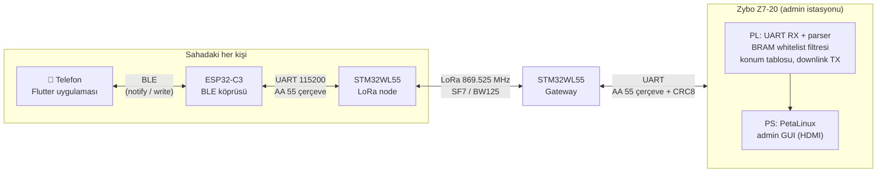

# LoRa Sub-GHz Takip Sistemi (internetsiz, ATAK benzeri)

> **Durum:** Geliştirme / prototip (Ekim 2026) · EMPA Elektronik stajında, mentör liderliğinde 4 kişilik ekip projesi
> **Benim payım:** STM32WL node + gateway firmware'i, ESP32-C3 BLE köprüsü, Flutter mobil uygulama

Sahada birbirini göremeyen kişilerin **internet ve hücresel şebeke olmadan** birbirinin konumunu görebildiği, haritaya işaret koyup komut gönderebildiği bir "kendi AirTag'imiz" sistemi. Her kişi bir **LoRa node** taşır; konumlar 868 MHz bandında bir **gateway**'e gider, **Zybo Z7-20** üzerindeki admin istasyonu donanımda (FPGA) filtreleyip "kim nerede" tablosunu herkese geri yayınlar. Kişiler kendi telefonlarında ATAK benzeri bir haritada herkesi görür.

<!-- TODO: masadaki kurulumun fotoğrafı (2 node + gateway + Zybo + telefon) -->

---

## Mimari

**Veri akışı:**

1. **Uplink (konum):** Node her ~5 s'de (± rastgele jitter) 12 baytlık konum paketi yayınlar → gateway paketi RSSI/SNR ekleyerek UART ile Zybo'ya iletir.
2. **Filtre:** Zybo'nun PL tarafı, gelen her paketin adresini BRAM'deki **whitelist** ile karşılaştırır; tanınmayan node'lar Linux'a hiç ulaşmaz.
3. **Downlink (tablo):** Zybo "kim nerede" tablosunu (0xD1) gateway'e yollar, gateway LoRa ile herkese yayınlar → her node tabloyu ESP32 üzerinden telefonuna iletir.
4. **Komutlar:** Telefondan konulan işaret/komut (0xC1) node → gateway yoluyla 3 kez tekrar yayınlanır, istenirse Zybo'ya da bildirilir. Silme istekleri (0xC2) yalnızca admin'e gider, admin kararı (0xC3) herkese yayınlanır.

Ayrıntılar: [docs/architecture.md](docs/architecture.md) · [docs/protocol.md](docs/protocol.md)

---

## Repo yapısı

| Klasör | İçerik | Teknoloji |
|---|---|---|
| [`firmware/stm32wl-node-gateway/`](firmware/stm32wl-node-gateway) | Node ve gateway için **tek** firmware; mod derleme bayraklarıyla seçilir | C, STM32CubeIDE, STM32WL SubGHz_Phy |
| [`firmware/esp32c3-ble-bridge/`](firmware/esp32c3-ble-bridge) | Node UART'ı ↔ BLE GATT köprüsü | C, ESP-IDF, NimBLE |
| [`app/lora_tracker/`](app/lora_tracker) | ATAK benzeri, yatay ekranlı offline harita uygulaması | Flutter / Dart |
| [`docs/`](docs) | Mimari, protokol, modül dokümanları, test notları | Markdown + Mermaid |

Zybo PL (FPGA) tasarımı ve admin GUI ekip arkadaşlarıma ait olduğu için bu repoda yok; arayüzleri [docs/protocol.md](docs/protocol.md) içinde tanımlı.

---

## Öne çıkan teknik noktalar

- **Tek kod tabanı, üç rol:** Aynı STM32 firmware'i `app_mode.h` içindeki bayraklarla node, gateway veya Zybo'suz test gateway'i olarak derlenir.
- **Donanım UID'sinden adres:** Node adresi, çipin 96-bit benzersiz kimliğinden 16 bit'e katlanarak üretilir; aynı binary her karta yüklenebilir. Ayrılmış adres aralıkları (0x0000 telefon, 0xFFFE admin, 0xFFFF herkes) korunur.
- **Kendi çerçeveleme protokolü:** Tüm UART bağlantılarında `AA 55 | LEN | payload | CRC8 (poly 0x07)`; byte byte çalışan durum makinesiyle senkron kaybından toparlanma.
- **Çakışma ve tekrar yönetimi:** TX zamanlayıcısına rastgele jitter, gateway'de 3× tekrar yayın, `(src, msg_id)` halka tamponuyla tekrar eleme, seq numarasıyla kayıp paket sayımı.
- **Düşük güç:** Node, köprü kapalıyken STOP2 uyku modunda çalışır; USART1 STOP2'de çalışmadığı için köprü/gateway modlarında uyku otomatik kapatılır.
- **Regülasyona uygun bant:** 869.4–869.65 MHz alt bandı (500 mW e.r.p., %10 duty cycle).
- **Tamamen offline harita:** Uygulama `.mbtiles` dosyasından harita çizer, konumu telefonun kendi GPS'inden alır; internet gerekmez.
- **Donanım değişikliğine hazırlık:** NUCLEO-WL55JC1'den Quectel KG200Z modülüne geçiş; RF switch, TCXO ve PA (LP/HP) ayarları kart bazında doğrulandı.

---

## Donanım

| Rol | Kart |
|---|---|
| Node / Gateway | ST NUCLEO-WL55JC1, Quectel KG200Z (STM32WLE5) |
| BLE köprüsü | ESP32-C3-DevKitM-1 |
| Admin istasyonu | Digilent Zybo Z7-20 (Zynq-7020) |
| Telefon | Android (iOS projesi de mevcut) |

---

## Hızlı başlangıç

1. **Firmware:** `firmware/stm32wl-node-gateway` → [README](firmware/stm32wl-node-gateway/README.md). `app_mode.h` ile rolü seç, STM32CubeIDE'de derle ve ST-LINK ile yükle.
2. **BLE köprüsü:** `firmware/esp32c3-ble-bridge` → `idf.py set-target esp32c3 build flash monitor`.
3. **Uygulama:** `app/lora_tracker` → offline harita dosyasını `assets/map.mbtiles` olarak ekle, `flutter run`.

Test ve devreye alma notları: [docs/bring-up-and-testing.md](docs/bring-up-and-testing.md)

---

## Ekran görüntüleri

| Uygulama: harita | Uygulama: işaret menüsü | Node log'u | Admin GUI |
|---|---|---|---|
|  |  |  |  |

<!-- Görselleri docs/images/ klasörüne bu isimlerle ekle; liste için docs/images/README.md -->

---

## Ekip ve katkı

Mentör liderliğinde 4 kişilik ekip projesi.

- **Aykut İsmet Aslantaş:** STM32WL node/gateway firmware'i, UART çerçeve protokolü, ESP32-C3 BLE köprüsü, Flutter mobil uygulama
- **Ekip arkadaşları:** Zybo PL tasarımı (UART RX, parser, BRAM whitelist, konum tablosu, downlink TX), PetaLinux ve admin GUI
