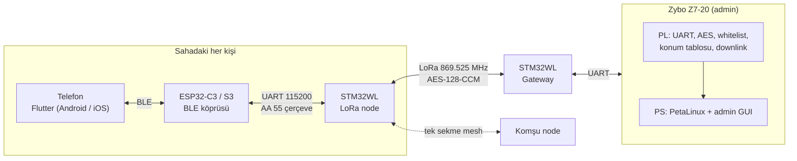

# LoRa Sub-GHz Takip Sistemi (internetsiz, ATAK benzeri)

Sahada birbirini göremeyen kişilerin **internet ve hücresel şebeke olmadan** birbirinin konumunu görebildiği, haritaya işaret koyup komut alabildiği bir takip sistemi. Her kişi bir **LoRa node** ve telefon taşır; konumlar 869 MHz'te bir **gateway**'e gider, **Zybo Z7-20** üzerindeki admin istasyonu paketleri donanımda (FPGA) doğrulayıp "kim nerede" tablosunu herkese geri yayınlar.

> **Durum:** Çalışan prototip (Kasım 2026, firmware V1.16.0). Mentör liderliğinde 4 kişilik ekip projesi.
> **Benim payım:** STM32WL node + gateway firmware'i, ESP32 BLE köprüsü, Flutter mobil uygulama, protokol tasarımı.

## Mimari

1. Node 5–6 sn'de bir konumunu (telefonun GPS'i) yayınlar; gateway paketi açmadan Zybo'ya iletir.
2. Zybo paketi doğrular, whitelist'e bakar, tabloyu günceller ve 10 sn'de bir **konum tablosunu** herkese yollar.
3. Telefonlar tabloyu haritada gösterir; işaret ve komutlar Zybo üzerinden herkese dağıtılır.

Ayrıntılar: [docs/architecture.md](docs/architecture.md) · [docs/protocol.md](docs/protocol.md) · [docs/bring-up-and-testing.md](docs/bring-up-and-testing.md)

## Öne çıkanlar

- **Tek firmware, iki rol:** Aynı STM32 kodu `app_mode.h`'taki bayraklarla node ya da gateway olarak derlenir.
- **Takımlı kimlik (JOIN):** Node telefondan takım/numara/PIN ile katılır, admin onaylar; adres (ör. `ALPHA-2 = 0x8102`) flash'ta saklanır. Admin node'u takımdan atabilir, node kendisi ayrılabilir.
- **Onaylı komutlar:** Admin komutlarına iki aşamalı ACK (ULAŞTI / OKUNDU); kayıp ve çakışmaya karşı tekrar ve tekrar eleme.
- **Tek sekme mesh:** Gateway'i duymayan node "beni aktarın" der, komşusu konumunu ve komutlarını iki yönde taşır.
- **Güvenlik (Faz 1):** Havadaki her paket AES-128-CCM ile şifreli ve imzalı (4 B MIC); sayaç + 32'lik pencereyle replay koruması, sayaç flash'ta yıpratmadan saklanır.
- **Donanımda filtre:** Whitelist ve doğrulama Zybo'nun PL tarafında; tanınmayan paket Linux'a ulaşmaz.
- **Tamamen offline:** Harita `.mbtiles` dosyasından çizilir.
- **PC'de test:** Firmware mantığı sahte HAL/radyo ile PC'de test edilir (`firmware/stm32wl-node-gateway/tests`).

## Repo yapısı

| Klasör | İçerik |
|---|---|
| [`firmware/stm32wl-node-gateway/`](firmware/stm32wl-node-gateway) | STM32WL node/gateway firmware'i (C, STM32CubeIDE) ve PC testleri |
| [`firmware/esp32c3-ble-bridge/`](firmware/esp32c3-ble-bridge) | Node UART'ı ↔ BLE köprüsü (ESP-IDF, NimBLE; C3 ve S3) |
| [`app/lora_tracker/`](app/lora_tracker) | Flutter harita uygulaması (Android, iOS) |
| [`docs/`](docs) | Mimari, protokol, test notları |

Zybo PL tasarımı ve admin GUI ekip arkadaşıma ait olduğu için bu repoda yok; arayüzleri [docs/protocol.md](docs/protocol.md) içinde.

## Donanım

| Rol | Kart |
|---|---|
| Node / gateway | NUCLEO-WL55JC1, Quectel KG200Z (STM32WLE5) |
| BLE köprüsü | ESP32-C3-DevKitM-1, ESP32-S3 |
| Admin | Digilent Zybo Z7-20 (Zynq-7020) |
| Telefon | Android, iPhone |

## Hızlı başlangıç

1. **Firmware:** [firmware/stm32wl-node-gateway/README.md](firmware/stm32wl-node-gateway/README.md). `net_key.example.h` → `net_key.h`, `app_mode.h` ile rolü seç, STM32CubeIDE'de derle.
2. **BLE köprüsü:** `idf.py set-target esp32c3` (ya da `esp32s3`) → `idf.py build flash monitor`.
3. **Uygulama:** harita dosyasını `assets/map.mbtiles` olarak ekle → `flutter run`. iPhone için: [app/lora_tracker/README.md](app/lora_tracker/README.md).

## Ekip

- **Aykut İsmet Aslantaş:** STM32WL firmware, protokol (JOIN, ACK, mesh, güvenlik), ESP32 köprüsü, Flutter uygulaması
- **Ekip arkadaşları:** Zybo PL tasarımı (UART, AES çekirdeği, whitelist, tablo), PetaLinux ve admin GUI
