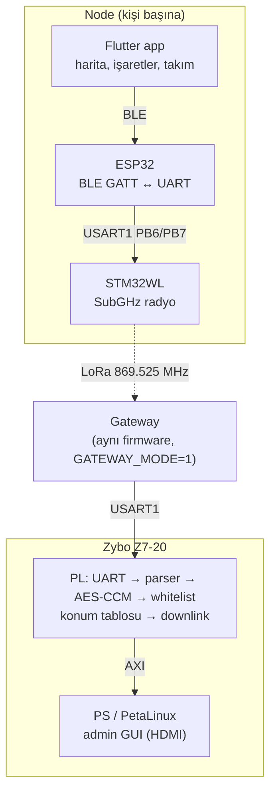
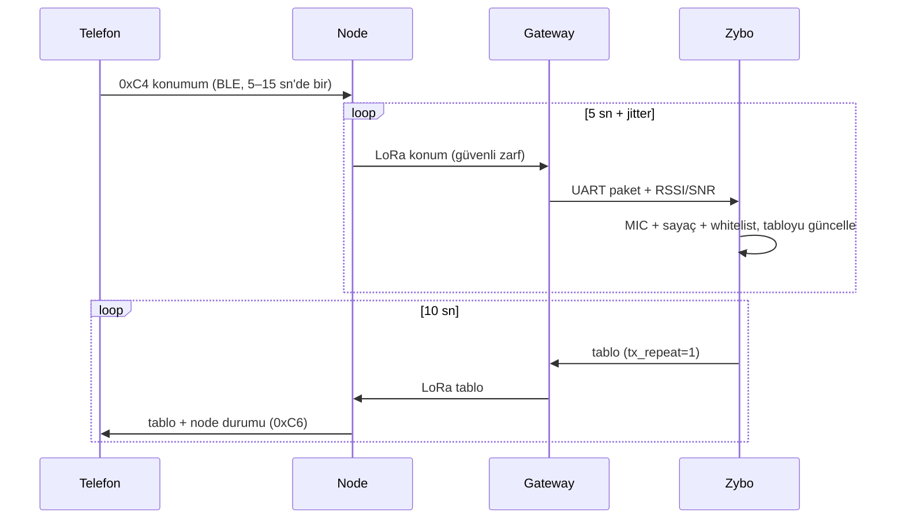
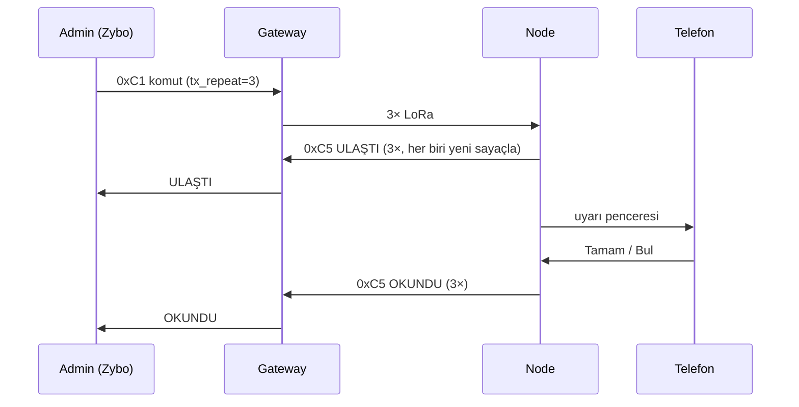
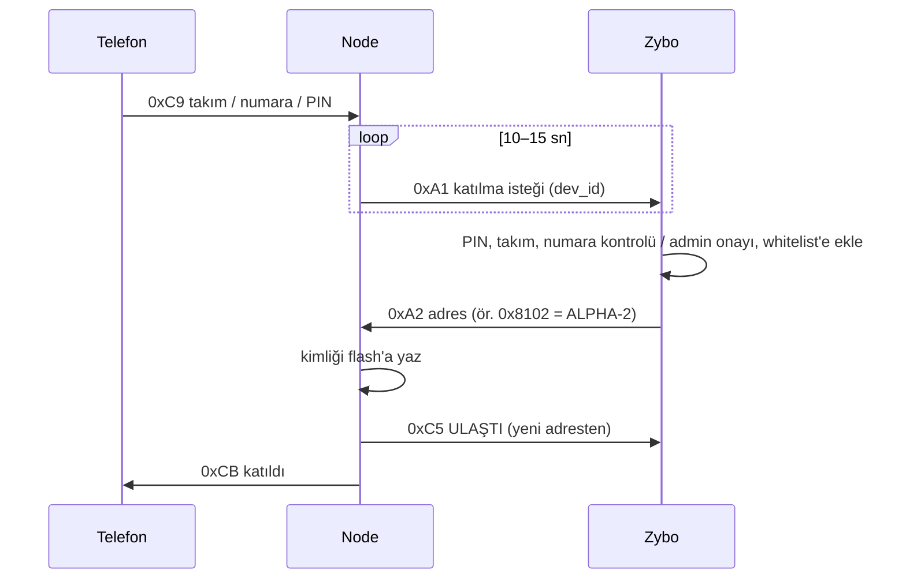
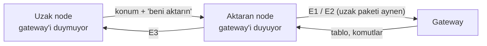

# Mimari

## Gereksinimler

- Sistem **tamamen yerel** çalışmalı: internet, bulut ya da hücresel şebeke yok.
- Kişi sayısı sabit değil (hedef ~16–30 node).
- Admin istasyonu tanınmayan cihazları **donanım seviyesinde** filtrelemeli.
- Saha kullanıcısı herkesi haritada görmeli, işaret koyabilmeli, admin'den komut alabilmeli.
- Havadaki trafik dinlenemez, taklit edilemez ve tekrar oynatılamaz olmalı.

## Bileşenler

| Bileşen | Görevi |
|---|---|
| **Telefon** | Harita, işaret koyma, takıma katılma; kendi GPS'ini node'a verir (`0xC4`) |
| **ESP32** | STM32WL'de BLE olmadığı için köprü: UART çerçevesi ↔ BLE notify/write |
| **Node** | Konumu yayınlar, tabloyu ve komutları telefona iletir, ACK yollar, gerekirse komşusunu aktarır |
| **Gateway** | Radyo ile Zybo arasında boru: duyduğunu Zybo'ya, Zybo'nun yolladığını havaya |
| **Zybo PL** | Doğrulama (AES), whitelist, konum tablosu, admin paketleri |
| **Zybo PS** | Admin GUI: harita, onay/red, komutlar, takım yönetimi |

## Konum akışı

Node gelen tabloda kendi kaydını arar; konumu tabloda varsa admin'e ulaşıyor demektir (telefondaki **Admin ✓** çipi). Konum paketlerine ayrı ACK yok, bu dolaylı onay yeterli.

## Komutlar ve onaylar

- Telefondan konulan işaret önce Zybo'ya gider; Zybo doğrulayıp herkese yayınlar. Gönderen telefon bu yayını duyunca işaret **✓✓** olur (yankı onayı).
- Silme isteği (`0xC2`) sadece admin'e gider; admin kararı (`0xC3`) herkese yayınlanır.
- Half-duplex LoRa'da çakışmalar yüzünden ACK'ler 3 kez yollanır; tekrarlar `(tip, src, msg_id)` ile elenir.

## Takımlı kimlik (JOIN)

Kimliği olmayan node konum yollamaz. Admin node'u atabilir (`0xA3`), node kendisi ayrılabilir (`0xA4`); her iki durumda kimlik silinir ve node katılma moduna döner.

## Tek sekme mesh

- Node 25 sn tabloda kendini doğrudan görmezse aktarım ister; admin'e doğrudan ulaşan bir komşu rastgele kısa bir beklemeden sonra aktarır. Başka bir komşu önce aktarırsa kendi aktarımını iptal eder.
- Aktarılan paket tekrar aktarılmaz (en fazla bir aracı).
- Zybo aktarılmış konumu tabloda işaretler; node "aktarımla ulaşıyorum" bilgisini doğrudan ulaşmakla karıştırmaz, bayrak açılıp kapanmaz.

## Güvenlik (Faz 1)

- Havadaki her paket **AES-128-CCM** ile şifrelenir ve 4 B MIC ile imzalanır. Faz 1'de tek ortak ağ anahtarı var.
- **Nonce** = dev_id + sayaç + yön. Adres yerine dev_id kullanılıyor, çünkü adres katılma ve atılmayla değişiyor.
- **Replay:** Gönderen başına son sayaç + 32'lik pencere. Sayaç flash'ta ayrı bir sayfada 256 pakette bir saklanır; açılışta +256 ile devam eder, sayfa ancak 256 yuva dolunca silinir.
- **Gateway anahtarı bilmez:** Paketleri açmadan taşır. Doğrulama, işaretlerin yeniden yayını ve aktarılmış paketlerin çözülmesi Zybo'da.
- **İç içe aktarım:** Aktaran node uzak node'un paketini açmadan taşır. Node başına anahtara geçildiğinde de çalışacak şekilde.
- **Geçiş:** `SECURE_ONLY=0` iken düz paketler de kabul edilir (adım adım geçiş için), `1` iken sadece güvenli paketler.

Sonraki aşama (Faz 2–3): node başına cihaz anahtarı + grup anahtarı, atılan node'da grup anahtarının yenilenmesi, telefon–ESP32 BLE bağlantısının şifrelenmesi.

## Firmware bayrakları (`Core/Inc/app_mode.h`)

| Bayrak | Etki |
|---|---|
| `GATEWAY_MODE` | 0 node, 1 gateway |
| `NODE_UART_BRIDGE` | Node'un ESP32/telefonla konuşması (açıkken STOP2 uyku kapanır) |
| `JOIN_ENABLED` | Takımlı kimlik (kapalıysa adres UID'den) |
| `SECURE_ENABLED`, `SECURE_ONLY` | Güvenli zarf, sadece-güvenli mod |
| `GW_FORWARD_CMD`, `GW_FORWARD_RELAY_INFO` | Düz modda gateway'in Zybo'ya ilettikleri |
| `GATEWAY_LOCAL_TABLE` | Zybo'suz test: gateway tabloyu kendisi tutar (sadece düz mod) |
| `VIRTUAL_NODES` | Test için tek kartın birden çok node gibi yayın yapması |
| `TEST_FAR_NODE`, `TEST_GW_IGNORE_DIRECT` | Masada mesh testi (saha öncesi 0) |

## Tasarım kararları

| Karar | Gerekçe |
|---|---|
| Ham LoRa (SubGHz_Phy), LoRaWAN değil | Ağ sunucusu ve internet olmadan kendi protokolümüz; düşük gecikme |
| 869.4–869.65 MHz alt bandı | Avrupa SRD kuralları altında en yüksek izinli güç (500 mW e.r.p.) ve %10 duty cycle |
| SF7 / BW125 | Kısa yayın süresi: konum 41 ms (güvenli 62 ms), 16 kayıtlık güvenli tablo ~330 ms |
| TX jitter, rastgele ACK aralıkları | Aynı anda yayın yapan node'ların sürekli çakışmasını önler |
| Whitelist ve doğrulama PL'de | Sabit gecikme; yetkisiz veri Linux'a hiç ulaşmaz |
| Telefonun GPS'i | Ayrı GPS modülüne gerek yok; telefon zaten kullanıcının yanında |
| Offline mbtiles | Sahada internet olmadan harita |
| Kendi uygulama, ATAK değil | Basit, ihtiyaca özel; ATAK'a benzer yatay arayüz |
