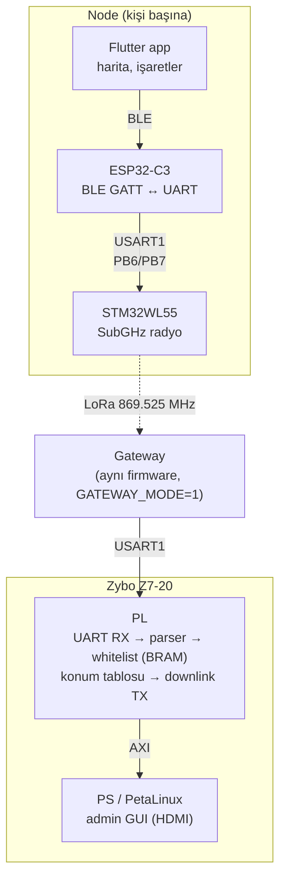
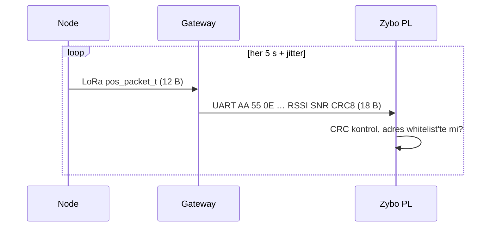
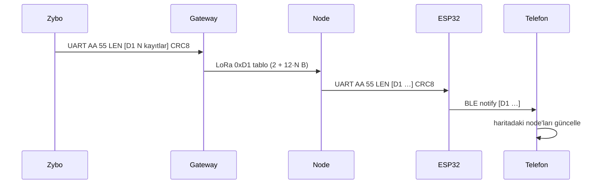
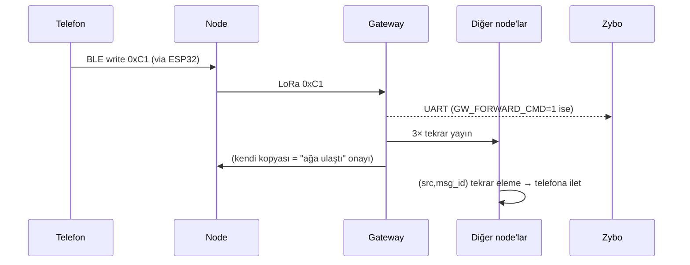

# Mimari

## Gereksinimler

- Sistem **tamamen yerel** çalışmalı: internet, bulut ya da hücresel şebeke yok.
- Kişi sayısı sabit değil (hedef ~30 node).
- Admin istasyonu tanınmayan cihazları **donanım seviyesinde** filtrelemeli.
- Saha kullanıcısı telefonundan herkesi haritada görebilmeli, işaret koyabilmeli, admin'den komut alabilmeli.

## Bileşenler

## Uplink: konum

Gateway'de **adres filtrelemesi yok**. Hangi node'un kabul edileceğine Zybo'nun PL tarafı karar verir; böylece whitelist tek yerde, donanımda tutulur ve Linux'a sadece onaylı veriler ulaşır.

## Downlink: konum tablosu

## Komutlar ve işaretler

- **0xC2 silme isteği** havada tekrar yayınlanmaz, yalnızca Zybo'ya gider.
- **0xC3 admin kararı** gateway tarafından 3× yayınlanır, telefonlar ilgili işareti haritadan kaldırır.
- **Kind 7 "geri dön"** yalnızca admin'den tek bir node'a gönderilir; diğer node'lar bunu kendi telefonlarına iletmez.

## Firmware modları

| Bayrak | Değer | Etki |
|---|---|---|
| `GATEWAY_MODE` | 0 / 1 | Node mu gateway mi |
| `VIRTUAL_NODES` | 1–8 | Test için tek kartın birden çok node gibi yayın yapması |
| `GATEWAY_LOCAL_TABLE` | 0 / 1 | Zybo yokken gateway tabloyu kendisi tutar ve 10 s'de bir yayınlar |
| `NODE_UART_BRIDGE` | 0 / 1 | Node'un tabloyu ESP32'ye iletmesi (açıkken STOP2 kapanır) |
| `GW_FORWARD_CMD` | 0 / 1 | Gateway'in komutları Zybo'ya iletmesi |

Bu bayraklar sayesinde sistem parça parça test edilebildi: önce iki NUCLEO arasında ping-pong, sonra Zybo'suz yerel tablo, sonra sanal node'larla çok node'lu senaryo, en son gerçek Zybo ile.

## Tasarım kararları

| Karar | Gerekçe |
|---|---|
| LoRaWAN yerine ham LoRa (SubGHz_Phy) | Ağ sunucusu ve internet gerektirmeden kendi protokolümüz; düşük gecikme |
| 869.4–869.65 MHz alt bandı | Avrupa SRD kuralları altında en yüksek izinli güç (500 mW e.r.p.) ve %10 duty cycle |
| SF7 / BW125 | Kısa yayın süresi: 12 B konum paketi ≈ 41 ms, 15 B komut ≈ 46 ms. En büyük tablo (21 kayıt, 254 B) ≈ 400 ms, bu yüzden tablo periyodu duty cycle hesabında dikkate alınmalı |
| TX jitter | Aynı anda açılan node'ların sürekli çakışmasını önler |
| Whitelist PL'de | Filtre gecikmesi sabit ve yazılımdan bağımsız; yetkisiz veri Linux'a hiç ulaşmaz |
| ESP32 köprüsü | STM32WL'de BLE yok; telefonla en basit kablosuz bağlantı |
| Offline mbtiles | Sahada internet olmadan harita |
| ATAK yerine kendi uygulama | Basit, ihtiyaca özel; mentör geri bildirimiyle ATAK'a benzer yatay arayüz |
